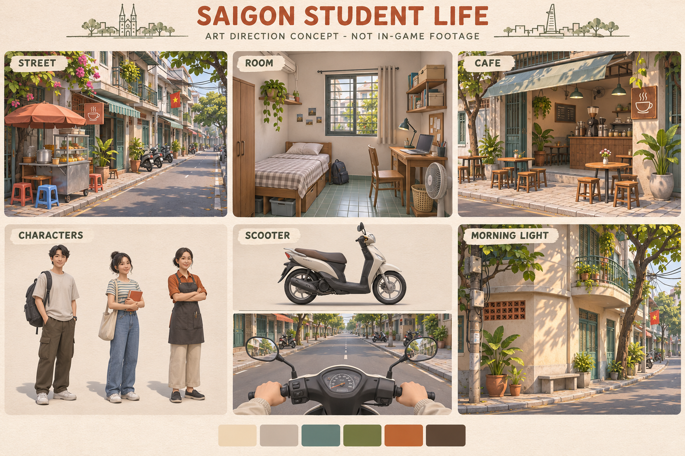

# Hướng mỹ thuật — chờ duyệt

Stylized bán hiện thực; chi tiết vừa, nhân vật tỉ lệ gần thật và mặt đơn giản;
phong cách thống nhất giữa môi trường, người và xe. Nắng sáng ấm, cây xanh,
biển hiệu, phòng trọ nhỏ, quán mở ra vỉa hè. Ưu tiên bố cục và vật liệu hơn mật độ đồ vật.

Bảng concept sáu ô đã được tạo bằng công cụ ImageGen tích hợp, không dùng API trả phí riêng.
Đây là hình minh họa hướng thiết kế, **không phải ảnh in-game, tài nguyên 3D hay bằng chứng hiệu năng**.

| Ô | Nội dung cần duyệt |
|---|---|
| STREET | Nhà phố/hẻm sinh viên Sài Gòn, lối đi dễ đọc, biển hiệu tiết chế |
| ROOM | Phòng trọ nhỏ: giường, bàn học, laptop, nền gạch |
| CAFE | Quán nhỏ, quầy và bàn ghế, mặt tiền mở |
| CHARACTERS | Ba nhân vật tỉ lệ gần thật, mặt đơn giản, quần áo đồng bộ |
| SCOOTER | Xe không nhãn hiệu, góc nhìn tay lái thoáng |
| MORNING LIGHT | Nắng ấm, bóng mềm vừa, nền kem/xám, xanh cây và cam tiết chế |

Trước khi sản xuất scene chính thức cần duyệt mức stylization, màu, nhân vật và ánh sáng.
M0 không nhập asset bên ngoài vào Unity. Model ZIP chưa đủ nguồn/giấy phép sẽ không sử dụng.

Prompt định hướng: sáu ô STREET/ROOM/CAFE/CHARACTERS/SCOOTER/MORNING LIGHT;
medium-detail stylized semi-realistic 3D; Saigon student neighborhood; warm natural morning light;
cream/gray, muted teal, restrained burnt orange, green plants; no brands, no photorealism,
no extreme bloom or depth of field; label ART DIRECTION CONCEPT - NOT IN-GAME FOOTAGE.
